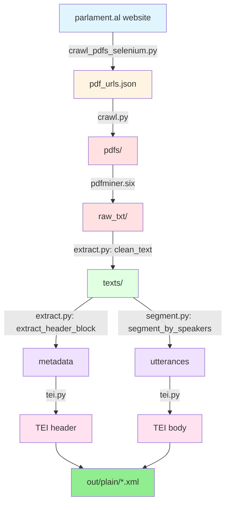

# ParlaMint-AL Pipeline: Complete Educational Guide

**A Step-by-Step Tutorial for Beginner Students**

This guide explains how the Albanian Parliament (ParlaMint-AL) corpus processing pipeline works, from downloading PDF files to generating TEI XML documents.

---

## Table of Contents

1. [Overview: How the Pipeline Works](#overview)
2. [Step 1: Crawling PDFs from Parliament Website](#step-1-crawling)
3. [Step 2: Extracting Text from PDFs](#step-2-extraction)
4. [Step 3: Cleaning & Normalizing Text](#step-3-cleaning)
5. [Step 4: Segmenting Speakers](#step-4-segmentation)
6. [Step 5: Building TEI XML](#step-5-tei)
7. [Running the Pipeline](#running)
8. [Directory Structure](#directories)

---

## Overview: How the Pipeline Works {#overview}

The pipeline has **two entry points**:

### Pipeline Flow Diagram


*This diagram shows the complete data flow from web crawling to TEI XML generation.*

### 1. Simple Wrapper: `run_pipeline.py`
**Best for students and everyday use**

```python
# File: run_pipeline.py
# This is a simple wrapper that calls the main pipeline with correct flags

def main():
    # Step 1: Optional - Crawl new PDFs
    if args.crawl:
        run: python3 src/crawl_pdfs_selenium.py --limit 10
    
    # Step 2: Process everything
    run: python3 -m src.pipeline --clean_from raw_txt --out out
```

### 2. Main Pipeline: `src/pipeline.py`
**The core orchestrator**

```python
# File: src/pipeline.py
# This coordinates all the processing steps

def main():
    # Step 0: Crawl PDFs (if URLs provided)
    _crawl_if_requested()
    
    # Step 1: Clean raw text → texts/
    if args.clean_from:
        clean_folder(raw_txt, texts)
    
    # Step 2: Convert cleaned text → TEI XML
    _convert_inbox_to_tei(texts, out)
```

---

## Step 1: Crawling PDFs from Parliament Website {#step-1-crawling}

### What Happens
The crawler visits `https://www.parlament.al/procesverbale` and automatically collects PDF download URLs.

### The Code: `src/crawl_pdfs_selenium.py`

```python
def crawl_pdf_urls(limit=10, headless=True):
    """
    Crawl the parliament website to collect PDF URLs.
    """
    collected_urls = []
    
    # 1. Launch browser
    with sync_playwright() as p:
        browser = p.chromium.launch(headless=headless)
        page = browser.new_page()
        
        # 2. Navigate to parliament website
        page.goto("https://www.parlament.al/procesverbale")
        
        # 3. Wait for content to load
        page.wait_for_selector(".act-card-wrapper")
        
        # 4. Find all document cards
        cards = page.query_selector_all(".act-card-wrapper")
        
        # 5. For each document:
        for card in cards:
            if len(collected_urls) >= limit:
                break
            
            # Click download button
            download_btn = card.query_selector(".dynamic-button.view-act")
            download_btn.click()
            
            # Get PDF URL from new tab
            new_page = context.expect_page()
            pdf_url = new_page.url
            
            # Save URL if it's valid
            if 'kuvendiwebfiles.blob.core.windows.net' in pdf_url:
                collected_urls.append(pdf_url)
            
            new_page.close()
    
    # 6. Save URLs to pdf_urls.json
    save_urls(collected_urls, "pdf_urls.json")
    
    return collected_urls
```

### Output
- **File**: `pdf_urls.json`
- **Content**: List of 10 PDF URLs

```json
[
  "https://kuvendiwebfiles.blob.core.windows.net/webfiles/202601281031073596Komisoni%20Nisma%20qytetare%2013.11.2025pj%201.pdf",
  "https://kuvendiwebfiles.blob.core.windows.net/webfiles/202601261515145191Komisioni%20i%20Ligjeve%209.12.%202025.pdf",
  ...
]
```

---

## Step 2: Extracting Text from PDFs {#step-2-extraction}

### What Happens
Each PDF is downloaded and converted to plain text using `pdfminer.six`.

### The Code: `src/crawl.py`

```python
def crawl_urls(urls, pdf_out="pdfs", txt_out="raw_txt"):
    """
    Download PDFs and extract text.
    """
    pdf_dir = Path(pdf_out)
    txt_dir = Path(txt_out)
    
    for url in urls:
        # 1. Download PDF
        pdf_path = download_pdf(url, pdf_dir)
        
        # 2. Extract text from PDF
        text = pdf_to_text(pdf_path)
        
        # 3. Save as .txt file
        txt_path = txt_dir / (pdf_path.stem + "_.txt")
        write_txt(txt_path, text)
        
        print(f"[OK] {pdf_path.name} → {txt_path.name}")
```

#### Helper Functions

```python
def download_pdf(url, out_dir):
    """Download PDF from URL."""
    fname = _sanitize_filename_from_url(url)
    pdf_path = out_dir / fname
    
    # Stream download to file
    with requests.get(url, stream=True) as r:
        r.raise_for_status()
        with open(pdf_path, "wb") as f:
            for chunk in r.iter_content(chunk_size=1 << 20):
                f.write(chunk)
    
    return pdf_path

def pdf_to_text(pdf_path):
    """Extract text from PDF using pdfminer.six."""
    return extract_text(str(pdf_path))
```

### Output
- **Directory**: `pdfs/` - Downloaded PDF files
- **Directory**: `raw_txt/` - Extracted text files (unprocessed)

```
raw_txt/
├── 202601281031073596Komisoni_20Nisma_20qytetare_2013.11.2025pj_201_.txt
├── 202601261515145191Komisioni_20i_20Ligjeve_209.12._202025_.txt
└── ...
```

---

## Step 3: Cleaning & Normalizing Text {#step-3-cleaning}

### What Happens
Raw text is cleaned to remove page numbers, fix OCR errors, and extract metadata (date, time, chair, agenda).

### The Code: `src/extract.py`

```python
def clean_folder(inbox, cleaned):
    """Clean every *.txt in inbox into cleaned directory."""
    for p in sorted(inbox.glob("*.txt")):
        # 1. Read raw text
        raw = read_text(p)
        
        # 2. Clean it
        out = clean_text(raw)
        
        # 3. Write to cleaned directory
        write_text(cleaned / p.name, out)
```

#### The Cleaning Function

```python
def clean_text(raw_txt):
    """
    Clean raw text:
    - Remove page headers/footers
    - Fix OCR errors
    - Normalize newlines
    """
    txt = normalize_newlines(raw_txt)
    
    # 1. Remove page markers like "===== Page 12 ====="
    txt = PAGE_HDR_RE.sub("", txt)
    
    # 2. Remove standalone page numbers
    txt = PAGE_NUM_RE.sub("", txt)
    
    # 3. Fix OCR errors (Albanian-specific)
    txt = txt.replace(" é", " ë").replace("É", "Ë")  # Fix ë character
    txt = txt.replace("¢", "ç")                       # Fix ç character
    txt = re.sub(r"\bgë", "që", txt)                  # gë → që
    txt = re.sub(r"\bgy", "gj", txt)                  # gy → gj
    
    return txt
```

#### Metadata Extraction

```python
def extract_header_block(txt):
    """
    Extract metadata from cleaned text:
    - Event type (between "KUVENDI" and "PROCESVERBAL")
    - Date and time
    - Chair name and role
    - Agenda
    """
    lines = txt.splitlines()
    
    # 1. Find event type
    i_kv = lines.index("KUVENDI")
    i_proc = lines.index("PROCESVERBAL")
    event_lines = lines[i_kv + 1 : i_proc]
    
    # 2. Extract date and time
    # Pattern: "më 17.10.2025 ora 10:00"
    m = re.search(r"më\s*(\d{1,2})\.(\d{1,2})\.(\d{4}).*ora\s*(\d{1,2}:\d{2})", date_line)
    if m:
        d, mo, y, t = m.groups()
        date = f"{int(y):04d}-{int(mo):02d}-{int(d):02d}"
        time = t
    
    # 3. Extract chair (after "Drejton mbledhjen:")
    for idx, l in enumerate(lines):
        if l.startswith("Drejton mbledhjen"):
            chair_line = lines[idx + 1]
            parts = re.split(r"\s*[–—-]\s*", chair_line, maxsplit=1)
            chair_name = parts[0].strip()
            chair_role = parts[1].strip() if len(parts) > 1 else ""
    
    # 4. Extract agenda (between "Rendi i ditës:" and "HAPET MBLEDHJA")
    i_ag = lines.index("Rendi i ditës:")
    i_open = lines.index("HAPET MBLEDHJA")
    agenda_text = "\n".join(lines[i_ag + 1 : i_open])
    
    return {
        "eventType": "\n".join(event_lines),
        "date": date,
        "time": time,
        "chair_name": chair_name,
        "chair_role": chair_role,
        "agenda_text": agenda_text,
    }
```

### Output
- **Directory**: `texts/` - Cleaned, normalized text files

---

## Step 4: Segmenting Speakers {#step-4-segmentation}

### What Happens
The cleaned text is split into individual speaker utterances. Each speaker's text is identified and grouped together.

### The Code: `src/segment.py`

```python
def segment_by_speakers(clean_txt):
    """
    Segment text by speakers.
    
    Returns:
    {
        "header_text": "text before HAPET MBLEDHJA",
        "utterances": [
            {"who_name": "Erion Braçe", "paragraphs": ["text...", "more text..."]},
            {"who_name": "Lindita Nikolla", "paragraphs": ["text..."]},
            ...
        ]
    }
    """
    # 1. Split at "HAPET MBLEDHJA" marker
    header_txt, body_txt = _split_header_body(clean_txt)
    
    # 2. Reconstruct broken lines (heal sentences split across lines)
    body_txt = reconstruct_broken_lines(body_txt)
    
    # 3. Ensure speaker cues start new paragraphs
    body_txt = _reinsert_breaks_before_cues(body_txt)
    
    # 4. Split into paragraphs
    paras = split_paragraphs(body_txt)
    
    # 5. Process each paragraph
    utterances = []
    current = None
    
    for para in paras:
        # Check if paragraph starts with speaker cue
        # Pattern: "Name Surname – text..."
        m = SPEAKER_RE.match(para)
        
        if m:
            # New speaker found
            if current:
                utterances.append(current)  # Save previous speaker
            
            who = m.group("name").strip()
            rest = m.group("rest").strip()
            current = {"who_name": who, "paragraphs": [rest] if rest else []}
        else:
            # Continuation of current speaker
            if current:
                current["paragraphs"].append(para)
    
    # Save last speaker
    if current:
        utterances.append(current)
    
    return {"header_text": header_txt, "utterances": utterances}
```

#### Speaker Pattern Recognition

```python
# Speaker cue pattern: "Name Surname – text"
SPEAKER_RE = re.compile(
    r"^\s*(?P<name>[A-ZÇË][\wÀ-ÖØ-öø-ÿÇËçë''\.\-]*\s+[A-ZÇË][\wÀ-ÖØ-öø-ÿÇËçë''\.\-]*)\s*[–—-]\s*(?P<rest>.+)$",
    flags=re.UNICODE | re.DOTALL,
)
```

**Examples of speaker cues:**
- `Erion Braçe – Faleminderit, zonja Kryetare.`
- `Lindita Nikolla – Ju lutem, vazhdoni.`
- `Taulant Balla – Unë mendoj që...`

#### Line Reconstruction

```python
def reconstruct_broken_lines(text):
    """
    Merge lines that don't end with punctuation.
    
    Example:
    Before:
        "Unë mendoj që kjo është
        një ide e mirë."
    
    After:
        "Unë mendoj që kjo është një ide e mirë."
    """
    lines = text.splitlines()
    out = []
    buffer = lines[0]
    
    for next_line in lines[1:]:
        # Check if current buffer ends with punctuation
        if RE_VALID_PUNCT_END.search(buffer):
            out.append(buffer)
            buffer = next_line
        else:
            # Merge with next line
            buffer = buffer.strip() + " " + next_line.strip()
    
    if buffer:
        out.append(buffer)
    
    return "\n".join(out)
```

### Output
Structured data with speakers and their utterances:

```python
{
    "header_text": "KUVENDI\nKomisioni i Ligjeve\nPROCESVERBAL\n...",
    "utterances": [
        {
            "who_name": "Erion Braçe",
            "paragraphs": [
                "Faleminderit, zonja Kryetare.",
                "Unë mendoj që kjo është një çështje e rëndësishme..."
            ]
        },
        {
            "who_name": "Lindita Nikolla",
            "paragraphs": [
                "Ju lutem, vazhdoni me diskutimin."
            ]
        }
    ]
}
```

---

## Step 5: Building TEI XML {#step-5-tei}

### What Happens
The segmented utterances are converted to TEI XML format, following the ParlaMint standard.

### The Code: `src/tei.py`

```python
def write_plain_day(session, speakers_idx, out_path, license_url, eventTypeAna):
    """
    Write a TEI XML file for one day's session.
    
    session = {
        "title": "Kuvendi i Shqipërisë – Procesverbal – 2025-11-13",
        "date": "2025-11-13",
        "time": "10:00",
        "eventType": "Komisioni i Ligjeve",
        "chair_name": "Erion Braçe",
        "chair_role": "Kryetar",
        "agenda_text": "1. Diskutim mbi...\n2. Votim për...",
        "utterances": [...]
    }
    """
    # 1. Create TEI root with header
    root = tei_root(session["title"], session["date"], license_url)
    
    # 2. Add meeting information to header
    teiHeader = root.find("teiHeader")
    titleStmt = teiHeader.find(".//titleStmt")
    meeting = ET.SubElement(titleStmt, "meeting")
    
    # Add event type
    for line in session["eventType"].splitlines():
        ET.SubElement(meeting, "p").text = line
    
    # Add date, time, chair
    ET.SubElement(meeting, "date", {"when": session["date"]}).text = session["date"]
    ET.SubElement(meeting, "time").text = session["time"]
    ET.SubElement(meeting, "chair").text = f"{session['chair_name']} — {session['chair_role']}"
    
    # 3. Create text/body/div structure
    text = ET.SubElement(root, "text", {"xml:lang": "sq"})
    body = ET.SubElement(text, "body")
    div = ET.SubElement(body, "div", {"type": "debateSection", "ana": eventTypeAna})
    
    # 4. Add utterances
    date_key = session["date"].replace("-", "")  # "20251113"
    
    for i, u in enumerate(session["utterances"], 1):
        who_name = u["who_name"]
        pid = speakers_idx.get(who_name.lower())  # Get person ID
        who_ref = f"#{pid}" if pid else "#pAL_UNKNOWN"
        
        # Create <u> element for utterance
        u_el = ET.SubElement(div, "u", {
            "xml:id": f"uAL_{date_key}_{i:04d}",  # e.g., "uAL_20251113_0001"
            "who": who_ref,
            "ana": "#parla.speaker"
        })
        
        # Add paragraphs as <seg> elements
        for para in u["paragraphs"]:
            seg_el = ET.SubElement(u_el, "seg")
            seg_el.text = squash_ws(para)  # Normalize whitespace
    
    # 5. Write XML file
    ET.ElementTree(root).write(out_path, encoding="utf-8", xml_declaration=True)
```

#### TEI Header Structure

```python
def tei_root(title, when_iso, license_url):
    """
    Create TEI root element with complete header.
    """
    root = ET.Element("TEI", xmlns="http://www.tei-c.org/ns/1.0")
    teiHeader = ET.SubElement(root, "teiHeader")
    
    # File description
    fileDesc = ET.SubElement(teiHeader, "fileDesc")
    titleStmt = ET.SubElement(fileDesc, "titleStmt")
    ET.SubElement(titleStmt, "title", {"type": "main"}).text = title
    
    # Publication info
    publicationStmt = ET.SubElement(fileDesc, "publicationStmt")
    ET.SubElement(publicationStmt, "publisher").text = "Kuvendi i Shqipërisë; CLARIN ERIC"
    ET.SubElement(publicationStmt, "pubPlace").text = "Tiranë"
    avail = ET.SubElement(publicationStmt, "availability", {"status": "free"})
    ET.SubElement(avail, "licence", {"target": license_url}).text = "CC BY 4.0"
    ET.SubElement(publicationStmt, "date", {"when": when_iso}).text = when_iso
    
    # Source description
    sourceDesc = ET.SubElement(fileDesc, "sourceDesc")
    bibl = ET.SubElement(sourceDesc, "bibl")
    ET.SubElement(bibl, "title").text = "Procesverbal i Kuvendit të Shqipërisë"
    ET.SubElement(bibl, "idno", {"type": "URL"}).text = "https://www.kuvendi.gov.al/"
    ET.SubElement(bibl, "date", {"when": when_iso}).text = when_iso
    
    # Encoding description (taxonomy)
    encodingDesc = ET.SubElement(teiHeader, "encodingDesc")
    projectDesc = ET.SubElement(encodingDesc, "projectDesc")
    ET.SubElement(projectDesc, "p").text = "ParlaMint-AL: korpus i krahasueshëm..."
    
    # Taxonomy for roles and events
    classDecl = ET.SubElement(encodingDesc, "classDecl")
    tax = ET.SubElement(classDecl, "taxonomy", {"xml:id": "parla-taxonomy"})
    
    # Speaker roles
    cat_roles = ET.SubElement(tax, "category", {"xml:id": "parla.roles"})
    cr1 = ET.SubElement(cat_roles, "category", {"xml:id": "parla.speaker"})
    ET.SubElement(cr1, "catDesc").text = "Folës"
    cr2 = ET.SubElement(cat_roles, "category", {"xml:id": "parla.chair"})
    ET.SubElement(cr2, "catDesc").text = "Kryetar/Moderues"
    
    # Event types
    cat_events = ET.SubElement(tax, "category", {"xml:id": "parla.events"})
    ce1 = ET.SubElement(cat_events, "category", {"xml:id": "parla.sitting"})
    ET.SubElement(ce1, "catDesc").text = "Seancë/mbledhje"
    ce2 = ET.SubElement(cat_events, "category", {"xml:id": "parla.committee"})
    ET.SubElement(ce2, "catDesc").text = "Komision"
    
    # Profile description
    profileDesc = ET.SubElement(teiHeader, "profileDesc")
    settingDesc = ET.SubElement(profileDesc, "settingDesc")
    setting = ET.SubElement(settingDesc, "setting")
    ET.SubElement(setting, "name").text = "Kuvendi i Shqipërisë"
    ET.SubElement(setting, "date", {"when": when_iso}).text = when_iso
    ET.SubElement(setting, "placeName").text = "Tiranë, AL"
    
    # Revision description
    revisionDesc = ET.SubElement(teiHeader, "revisionDesc")
    ET.SubElement(revisionDesc, "change", {"when": when_iso}).text = "Konvertimi fillestar në TEI"
    
    return root
```

### Output Example

```xml
<?xml version='1.0' encoding='utf-8'?>
<TEI xmlns="http://www.tei-c.org/ns/1.0">
  <teiHeader>
    <fileDesc>
      <titleStmt>
        <title type="main">Kuvendi i Shqipërisë – Procesverbal – Komisioni i Ligjeve – 2025-11-13</title>
        <meeting ana="#parla.sitting">
          <p>Komisioni i Ligjeve</p>
          <date when="2025-11-13">2025-11-13</date>
          <time>10:00</time>
          <chair>Erion Braçe — Kryetar</chair>
        </meeting>
      </titleStmt>
      <publicationStmt>
        <publisher>Kuvendi i Shqipërisë; CLARIN ERIC</publisher>
        <pubPlace>Tiranë</pubPlace>
        <availability status="free">
          <licence target="https://creativecommons.org/licenses/by/4.0/">CC BY 4.0</licence>
        </availability>
        <date when="2025-11-13">2025-11-13</date>
      </publicationStmt>
      <!-- ... more header ... -->
    </fileDesc>
  </teiHeader>
  <text xml:lang="sq">
    <body>
      <div type="debateSection" ana="#parla.sitting">
        <u xml:id="uAL_20251113_0001" who="#pAL.ErionBraçe" ana="#parla.speaker">
          <seg>Faleminderit, zonja Kryetare.</seg>
          <seg>Unë mendoj që kjo është një çështje e rëndësishme për vendin tonë.</seg>
        </u>
        <u xml:id="uAL_20251113_0002" who="#pAL.LinditaNikolla" ana="#parla.speaker">
          <seg>Ju lutem, vazhdoni me diskutimin.</seg>
        </u>
        <!-- ... more utterances ... -->
      </div>
    </body>
  </text>
</TEI>
```

### Output
- **Directory**: `out/plain/` - TEI XML files
- **Filename format**: `ParlaMint-AL_YYYY-MM-DD.xml`

---

## Running the Pipeline {#running}

### Method 1: Simple Wrapper (Recommended for Students)

```bash
# Process existing files
python3 run_pipeline.py

# Crawl fresh PDFs + process
python3 run_pipeline.py --crawl --limit 10
```

### Method 2: Main Pipeline (Advanced)

```bash
# Full pipeline with all steps
python3 -m src.pipeline --clean_from raw_txt --out out

# Just convert existing cleaned files
python3 -m src.pipeline --out out

# Crawl from URLs file
python3 -m src.pipeline --urls src/urls.txt --clean_from raw_txt --out out
```

### Method 3: Individual Steps

```bash
# Step 1: Crawl PDFs
python3 src/crawl_pdfs_selenium.py --limit 10

# Step 2: Extract text (if not done by crawler)
python3 -m src.crawl --urls pdf_urls.json

# Step 3: Clean text
python3 -m src.extract

# Step 4: Convert to TEI
python3 -m src.pipeline --out out
```

---

## Directory Structure {#directories}

```
Parlamint-al/
├── run_pipeline.py              # Simple wrapper script
├── pdf_urls.json                # List of PDF URLs (from crawler)
│
├── src/                         # Source code
│   ├── pipeline.py              # Main orchestrator
│   ├── crawl_pdfs_selenium.py   # Web crawler (Selenium)
│   ├── crawl.py                 # PDF downloader & text extractor
│   ├── extract.py               # Text cleaner & metadata extractor
│   ├── segment.py               # Speaker segmentation
│   ├── tei.py                   # TEI XML writer
│   ├── utils.py                 # Utility functions
│   └── config.py                # Configuration
│
├── pdfs/                        # Downloaded PDF files
│   ├── 202601281031073596Komisoni_20Nisma_20qytetare_2013.11.2025pj_201.pdf
│   └── ...
│
├── raw_txt/                     # Raw extracted text (unprocessed)
│   ├── 202601281031073596Komisoni_20Nisma_20qytetare_2013.11.2025pj_201_.txt
│   └── ...
│
├── texts/                       # Cleaned, normalized text
│   ├── 202601281031073596Komisoni_20Nisma_20qytetare_2013.11.2025pj_201_.txt
│   └── ...
│
└── out/                         # Final output
    └── plain/                   # TEI XML files
        ├── ParlaMint-AL_2025-11-13.xml
        └── ...
```

---

## Summary: Complete Data Flow



---

## Key Concepts for Students

### 1. **Pipeline Architecture**
The pipeline follows a **linear processing model**:
- Each step produces output for the next step
- Steps can be run independently or together
- Data flows through directories: `pdfs/` → `raw_txt/` → `texts/` → `out/plain/`

### 2. **Text Normalization**
Normalization means cleaning and standardizing text:
- Remove page numbers and headers
- Fix OCR errors (é → ë, ¢ → ç)
- Merge broken lines
- Preserve paragraph structure

### 3. **Speaker Segmentation**
Identifying who said what:
- Pattern matching for speaker cues (`Name Surname – text`)
- Grouping consecutive paragraphs by speaker
- Handling multi-paragraph utterances

### 4. **TEI XML Standard**
TEI (Text Encoding Initiative) is a standard for representing texts in digital form:
- Structured metadata (date, time, participants)
- Hierarchical organization (session → utterance → segment)
- Standardized annotations (speaker roles, event types)

### 5. **Metadata Extraction**
Pulling structured information from unstructured text:
- Regular expressions for pattern matching
- Positional markers ("KUVENDI", "PROCESVERBAL", "HAPET MBLEDHJA")
- Contextual clues ("Drejton mbledhjen:", "Rendi i ditës:")

---

## Practice Exercises for Students

1. **Trace a single PDF through the pipeline**
   - Pick one PDF URL
   - Follow it through each step
   - Examine the output at each stage

2. **Modify the cleaner**
   - Add a new OCR error pattern
   - Test it on sample text

3. **Understand speaker segmentation**
   - Find examples of speaker cues in raw text
   - See how they're split into utterances

4. **Explore TEI structure**
   - Open a generated XML file
   - Identify header vs. body
   - Count utterances and speakers

5. **Run the pipeline**
   - Start with 1 PDF
   - Gradually increase to 10
   - Observe processing time and output

---

**End of Guide**

For questions or issues, refer to the individual module documentation in each `.py` file.
